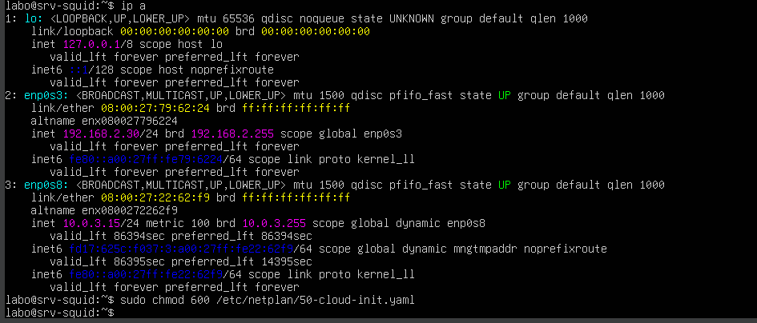
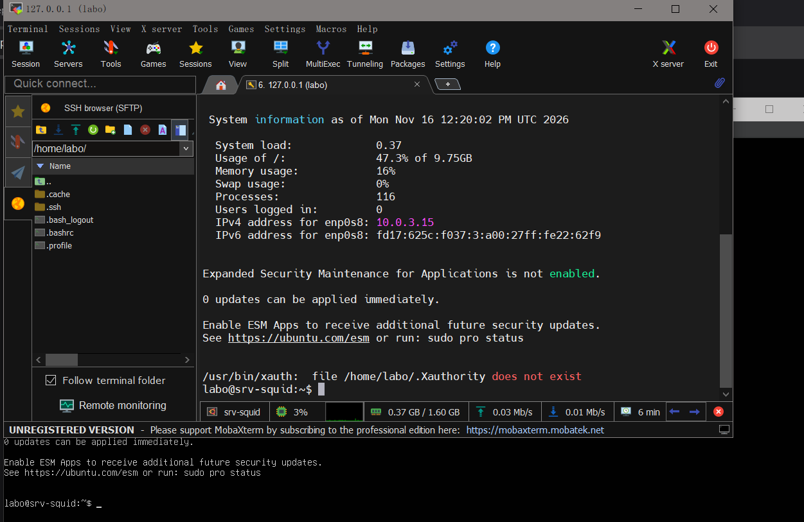
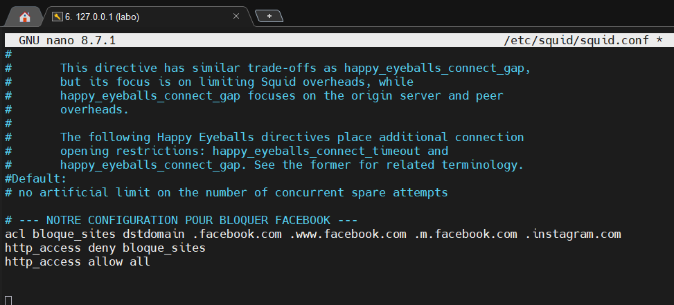
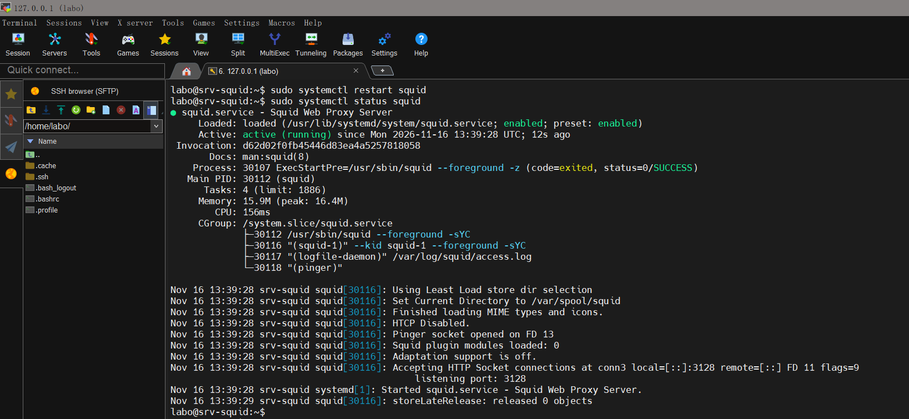
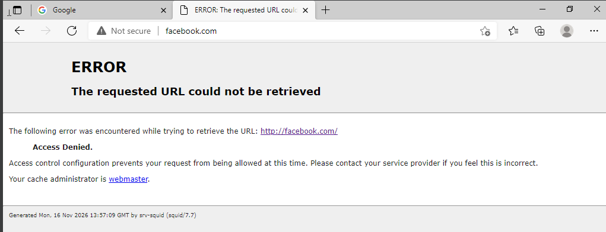
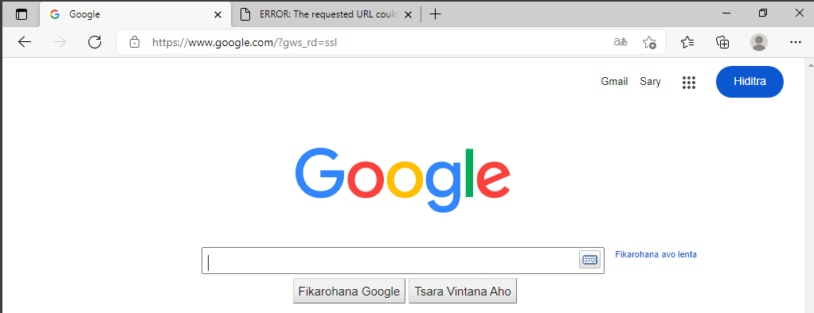
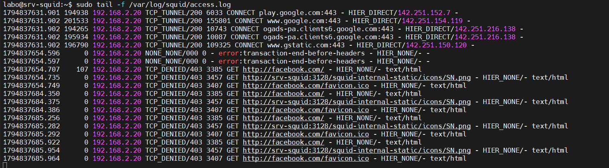

# 🐧 Projet 4 : Administration Linux & Sécurité Proxy (Squid)

Ce projet consiste à déployer un serveur Linux (Ubuntu Server) pour agir en tant que proxy filtrant. L'objectif est de sécuriser le réseau d'entreprise en bloquant l'accès à certains sites web (comme les réseaux sociaux) depuis un client Windows 10, tout en gérant l'administration à distance via SSH.

## 🎯 Objectifs du projet
* Installer et configurer un serveur Ubuntu Server en ligne de commande.
* Mettre en place une configuration réseau double (Interne + NAT pour Internet).
* Administrer le serveur à distance via SSH (avec MobaXterm).
* Installer et configurer le proxy **Squid**.
* Créer des règles de filtrage (ACL) pour bloquer Facebook et Instagram.
* Configurer le client Windows 10 pour router son trafic via le proxy.

## 🛠️ Environnement technique
* **Hyperviseur :** Oracle VirtualBox
* **Serveur Proxy :** Ubuntu Server (IP interne : `192.168.2.30`)
* **Client :** Windows 10 (IP : `192.168.2.20`)
* **Réseau :** Double carte réseau (Réseau Interne `labo-ad` + NAT pour l'accès Internet du serveur)
* **Outils d'administration :** MobaXterm (SSH avec redirection de port sur le port `2222`)
* **Logiciel Proxy :** Squid (Port `3128`)

## 🔧 Résolution de problèmes (Dépannage)
*(Les vrais défis rencontrés lors de ce labo)*
* **Blocage du trafic par le pare-feu Windows :** Le pare-feu de l'hôte bloquait le trafic NAT de VirtualBox. Une règle d'exception a été ajoutée pour autoriser VirtualBox.
* **Erreur de configuration Squid :** La règle `http_access deny all` par défaut a été déplacée et remplacée par nos propres règles d'ACL pour éviter les conflits.
* **Problème de résolution IPv6 :** Ubuntu tentait de joindre Google via IPv6 (non supporté par le réseau NAT). Le problème a été résolu en forçant l'utilisation d'IPv4 avec la directive `dns_v4_first on` dans la configuration de Squid.

## 🧪 Tests et Validations (Preuves)

**1. Configuration réseau d'Ubuntu (Double IP NAT + Interne)**

**2. Connexion à distance via SSH (MobaXterm)**

**3. Fichier de configuration Squid avec les règles de blocage**

**4. Statut du service Squid (Active Running)**

**5. Test de blocage : Facebook (Access Denied)**

**6. Test d'autorisation : Google (Accès OK)**

**7. Preuve technique : Logs d'accès Squid montrant le TCP_DENIED/403**

## 🧠 Compétences acquises
* Administration d'un serveur Linux (Ubuntu Server) en ligne de commande.
* Configuration réseau avancée (Netplan, NAT, Redirection de port).
* Utilisation de SSH pour l'administration à distance.
* Installation et configuration d'un proxy Squid avec gestion des ACL (Access Control Lists).
* Analyse de logs et dépannage réseau (Firewall, IPv6, règles de sécurité).
